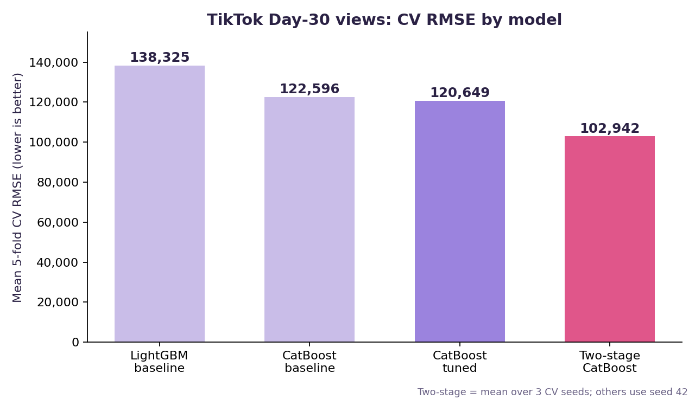

# TikTok Video Engagement Prediction

A complete, leakage-safe machine learning pipeline, from raw tables to a Kaggle submission, built for the WeCloudData Data Science Bootcamp in-class competition.

[](https://www.python.org/)
[](LICENSE)
[](https://www.kaggle.com/)
[](https://scikit-learn.org/)
[](https://pandas.pydata.org/)
[](https://jupyter.org/)
[](https://catboost.ai/)


---

## Overview

This repository contains a complete solution for predicting the cumulative
view count a TikTok video will reach at **Day 30**, using only information
available during the first **5 days** after publication.

The competition is hosted on Kaggle and evaluated using **Root Mean Squared
Error (RMSE)**.

---

## Objective

| Item | Description |
|---|---|
| **Target** | `target_day30_views` (cumulative views at Day 30) |
| **Features** | Video metadata, creator statistics, engagement (Days 0–5) |
| **Metric** | Root Mean Squared Error (RMSE) |
| **Constraint** | No leakage — only Days 0–5 engagement |

---

## Repository Structure

```
ds-tiktok-viral-predict/
│
├── README.md
├── requirements.txt
├── LICENSE
├── .gitignore
│
├── notebooks/
│   ├── 01_eda.ipynb                       # EDA, feature engineering, as-of merge
│   ├── 02_modeling.ipynb                  # CV, tuning, two-stage model, submission
│   └── experiments/
│       └── full_data_exploration.ipynb    # side exploration on the full 200k dataset
│
├── docs/
│   └── results.png                        # CV RMSE comparison chart
│
└── submissions/
    └── submission.csv                     # Final Kaggle submission
```

---

## Dataset

The dataset contains four tables:

| Table | Rows | Description |
|---|---:|---|
| `train_videos.csv` | 12,000 | Video metadata + target |
| `test_videos.csv` | 3,001 | Test videos (metadata only) |
| `engagement_daily.csv` | 79,489 | Daily engagement (video-day level) |
| `creators_daily.csv` | 252,166 | Daily creator stats (creator-day level) |

> **Note:** Raw data is not committed to this repository due to size
> constraints. See [How to Reproduce](#how-to-reproduce) below.

---

## Approach

### 1. Exploratory Data Analysis (`01_eda.ipynb`)

- Target is heavily right-skewed (**skewness ≈ 29**)
- Day 0 engagement is missing for **62%** of videos
- Top 100 videos = **58%** of total views
- Creator statistics require an **as-of merge** to avoid leakage

### 2. Feature Engineering

**Level features**
- `play_last`, `play_max`, `play_mean`, `play_std`
- `like_last`, `comment_last`, `share_last`, `collect_last`

**Growth features**
- `play_growth_5_3`
- `play_diff_5_4`, `play_diff_4_3`, `play_diff_3_2`

**Interaction ratios**
- `like_ratio`, `share_ratio`, `collect_ratio`

**Creator features (as-of merge)**
- `follower_count`, `total_favorited`, `video_count`

**Completeness features**
- `n_days`, `has_day0`, `has_day5`

> Five weak or noisy features (`growth_efficiency`, `comment_ratio`,
> `following_count`, `play_growth_5_1`, `play_growth_3_1`) are dropped at the
> start of modeling, leaving **55 model features**. The lists above are
> illustrative, not exhaustive.

### 3. Modeling (`02_modeling.ipynb`)

**Validation Strategy**
- Stratified K-Fold on **10 quantile bins** of the target
- **5 folds** with fixed random seed
- **Leakage-safe**: thresholds computed inside folds

**Baseline Results**

| Model | Mean CV RMSE |
|---|---:|
| LightGBM | ~138,300 |
| CatBoost | ~122,600 |

**Target Transformations Tested**
- `none`, `log1p`, `sqrt`, `cbrt`
- Best: none (raw target, ~122,600); `sqrt` ~122,900, `cbrt` ~124,800, `log1p` ~129,200 — transformations did not help

**Hyperparameter Tuning**
- Search over 8 hand-picked configurations of `depth`, `learning_rate`, `l2_leaf_reg`
- Best: `depth=5, lr=0.03, l2_leaf_reg=3` (~120,600)

### 4. Two-Stage Model (Final)

**Architecture**

1. **Stage 1 (Classifier)** — probability a video is "viral" (top 10%)
2. **Stage 2a (Regressor)** — views for all videos
3. **Stage 2b (Regressor)** — views for viral videos only
4. **Combine** — `P(viral) × pred_viral + (1 − P(viral)) × pred_all`

**Results Across 3 Seeds**

| Seed | CV RMSE |
|---|---:|
| 42 | ~105,759 |
| 123 | ~101,661 |
| 7 | ~101,406 |
| **Mean** | **~102,942** |
| **Std** (population, across seeds) | **~1,995** |

---

## Results

| Model | Mean CV RMSE |
|---|---:|
| LightGBM baseline | ~138,300 |
| CatBoost baseline | ~122,600 |
| Tuned CatBoost | ~120,600 |
| **Two-Stage CatBoost (final)** | **~102,942** |



**Kaggle Public LB:** **81,298**

> CV RMSE (~102,942) and the leaderboard score (81,298) are computed on different
> data, so they are not directly comparable. The leaderboard score is the one
> that reflects the held-out test set.

---

## How to Reproduce

### Step 1 — Clone the repository

```bash
git clone https://github.com/inoufalharbi/ds-tiktok-viral-predict.git
cd ds-tiktok-viral-predict
```

### Step 2 — Set up the environment

```bash
python -m venv .venv
source .venv/bin/activate       # Windows: .venv\Scripts\activate
pip install -r requirements.txt
```

### Step 3 — Download raw data

Download the competition data from
[Hugging Face](https://huggingface.co/datasets/lingbow/tiktok-video-engagement-200k)
and place the CSV files under `data/raw/`:

```
data/raw/
├── train_videos.csv
├── test_videos.csv
├── engagement_daily.csv
├── creators_daily.csv
└── sample_submission.csv
```

### Step 4 — Run the notebooks

```
1. Run notebooks/01_eda.ipynb      → generates data/processed/modeling_table.csv
2. Run notebooks/02_modeling.ipynb → generates submissions/submission.csv
```

---

## Requirements

See [`requirements.txt`](requirements.txt) for the full list.

**Core libraries**

- `numpy`, `pandas` — data manipulation
- `catboost`, `lightgbm`, `xgboost` — gradient boosting
- `scikit-learn` — model selection & metrics
- `matplotlib`, `seaborn` — visualization

---

## Validation Notes & Limitations

Being upfront about what the numbers do and do not show:

- **Seeds change the folds.** The baselines and tuned CatBoost were scored on
  the seed-42 split; the two-stage model is reported as the mean over three
  different splits (42, 123, 7). On the *same* seed-42 split, two-stage scores
  ~105,759 vs. ~120,649 for tuned CatBoost, which is still a clear gain.
- **High fold variance.** One fold (the one containing the most extreme
  videos) can reach ~236,000 RMSE while others are ~50,000, so single-fold
  numbers should not be over-read.
- **Light preprocessing outside the folds.** Label encoding, median
  imputation, and the removal of weak features (chosen from EDA correlations)
  were done on the full training table before CV. The viral threshold and all
  models are fit strictly inside each fold; the preprocessing above is a minor
  source of optimism, not a target leak.
- **Test features use the same pipeline** as training (as-of merge for creator
  stats, only Days 0-5 of engagement).

---

## Key Learnings

1. **Extreme skewness requires special handling** — standard regression
   underperforms on heavy-tailed targets.
2. **Stratified K-Fold is essential** — random K-Fold produces unstable
   estimates when the target is skewed.
3. **Two-Stage architecture works well** — separating "viral" from
   "normal" videos improves overall performance.
4. **CV and LB are not always aligned** — cross-validation can be
   optimistic while the leaderboard reflects the true test distribution.
5. **Leakage safety is non-negotiable** — as-of merges and in-fold
   threshold computation prevent future information leakage.

---

## Author

**Nouf Alharbi**

- GitHub: [@inoufalharbi](https://github.com/inoufalharbi)
- Bootcamp: WeCloudData Data Science Bootcamp (Saudi Digital Academy)

---

## License

This project is licensed under the MIT License — see the
[LICENSE](LICENSE) file for details.

---

## Acknowledgments

- **WeCloudData** — for organizing the competition
- **Kaggle** — for hosting the leaderboard
- **Hugging Face** — for providing the dataset
